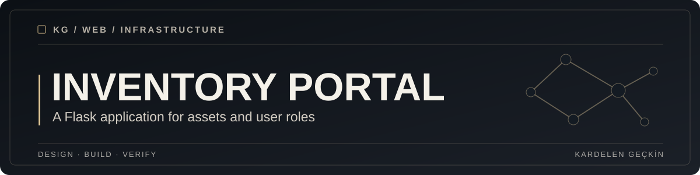
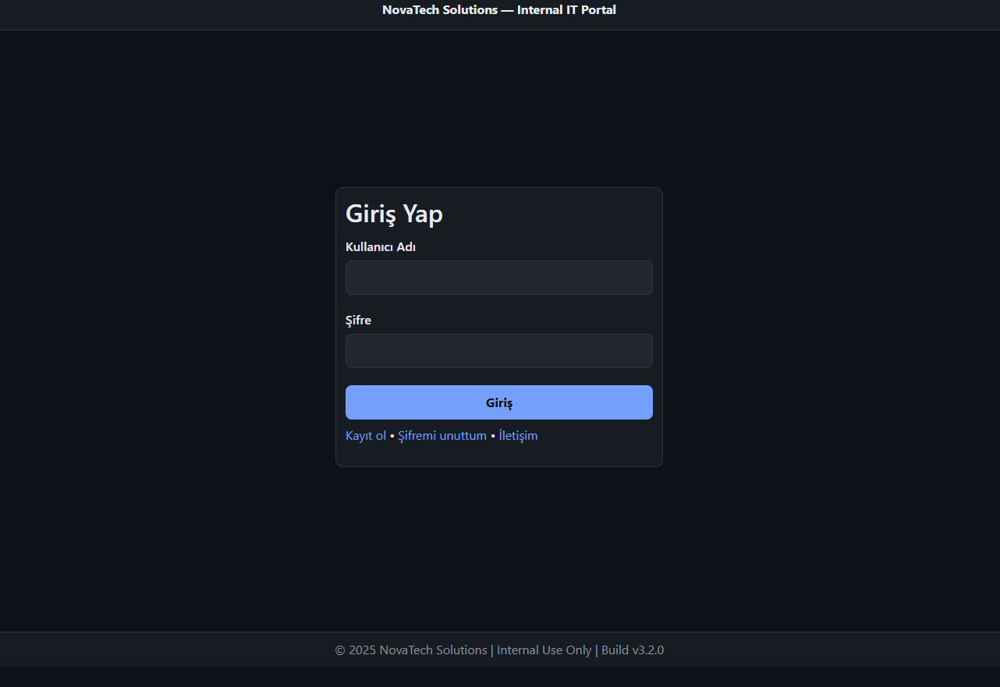
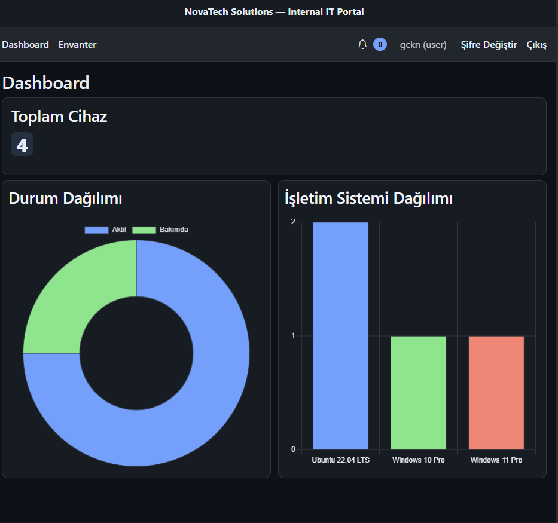
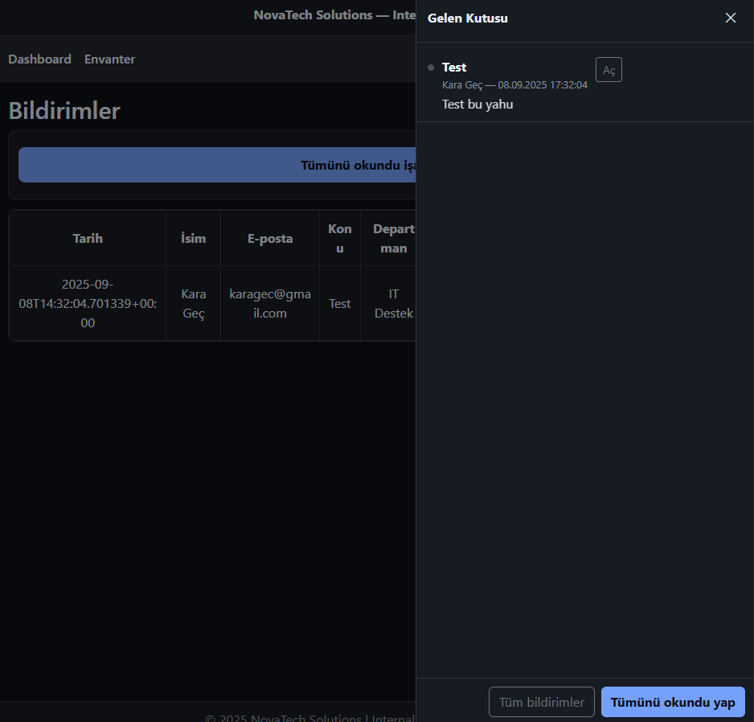
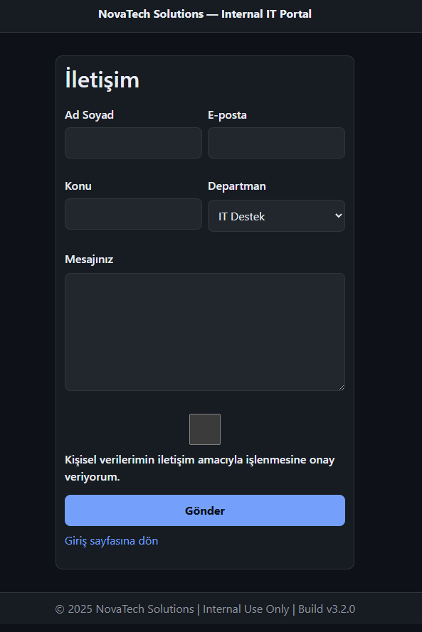

<div align="center">



**An educational inventory and user management portal with a dark responsive interface.**

[Getting started](#getting-started) · [Screenshots](#screenshots) · [Architecture](docs/ARCHITECTURE.md)

</div>

## Overview

Inventory Portal is a Flask prototype for practicing infrastructure asset
tracking, role aware administration, dashboard views and web application
development. It uses server rendered pages, client side JavaScript and JSON
files for local data.

## What it includes

* User login, admin role, registration and password reset demonstration.
* Inventory records with add, edit, delete, CSV and spreadsheet workflows.
* A status dashboard and notifications from a contact form.
* Responsive dark interface using HTML, CSS and JavaScript.

## Getting started

**Prerequisites:** Python 3.11 or later and a local development environment.

```bash
git clone https://github.com/kgeckin/W-Code2.0_FrontEnd.git
cd W-Code2.0_FrontEnd/HW
python -m venv .venv
```

Activate `.venv` using your operating system's Python environment command.

```bash
python -m pip install -r requirements.txt
```

Copy `.env.example` to `.env`, generate a strong secret key, and supply a
local administrator password hash. The supplied example hash is not a working
password. The helper `python hash_creator.py` can generate a password hash
for a password you choose locally.

```bash
python app.py
```

Open the local URL printed by Flask. The application is intended for
development use on `127.0.0.1`. Registration and development reset links
are disabled by default in the example configuration.

## Screenshots

| Login | Dashboard |
| :---: | :---: |
|  |  |

| Messages | Contact |
| :---: | :---: |
|  |  |

## Repository structure

```text
HW/
├── app.py                  # Flask routes and local data management
├── static/                 # JavaScript, CSS, images
├── templates/              # Server rendered pages
├── data/                   # Synthetic JSON demonstration records
├── screenshots/            # Interface screenshots
├── docs/                   # Design decisions and limitations
├── hash_creator.py         # Local password hash helper
├── .env.example            # Nonsecret settings template
└── requirements.txt
```

## Validation

The repository currently has no established automated test suite for this
application. Validate login, permission boundaries, inventory operations and
import/export behaviors with a local test environment and synthetic records.

## Architecture & decisions

The app keeps application routes in `app.py`, templates in `templates/`
and front end resources in `static/`. JSON documents act as a lightweight
teaching data store. Read [Architecture](docs/ARCHITECTURE.md) for the flow
and intended evolution.

## Security & limitations

This is a **local educational prototype**. It should not be hosted on the
public internet as currently written. The JSON store is not suitable for
concurrent use, state changing routes need systematic CSRF protection,
and user management needs a deeper role and privilege review. See
[Security](docs/SECURITY.md) before running it with any personal information.

Do not treat sample asset details, screenshot content or reset flows as
enterprise ready systems.

## License

No license file was found in the parent repository. Distribution and reuse
rights should be established before republishing.
