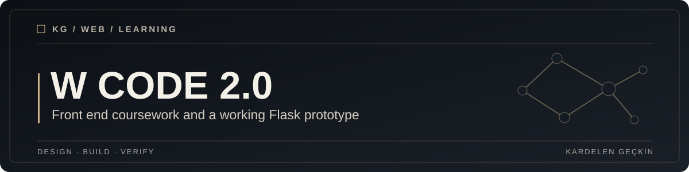

<div align="center">



**A collection of web development exercises with a featured infrastructure inventory application.**

[Featured application](HW/) · [Project source](HW/app.py) · [Screenshots](HW/screenshots/)

</div>

## Overview

This repository contains coursework from the W Code 2.0 Front End program
and a larger Flask application built to explore asset tracking, user roles,
dashboards and administration.

The `HW/` directory is the primary runnable example. The remaining
material is retained in its original educational context.

## What it includes

* Responsive HTML, CSS and JavaScript interface work.
* A Flask inventory portal with asset records and administrative roles.
* Example dashboards, contact forms, and import and export workflows.
* Screenshots and demonstration data for the featured application.

## Getting started

The featured application has its own dependencies and environment settings.
See the complete [Inventory Portal setup guide](HW/README.md).

```bash
cd HW
python -m pip install -r requirements.txt
python app.py
```

Configure `HW/.env` from `HW/.env.example` first. The sample application
is intended for local demonstration, not exposure to the public internet.

## Repository structure

```text
W-Code2.0_FrontEnd/
├── HW/
│   ├── app.py
│   ├── templates/
│   ├── static/
│   ├── data/
│   ├── screenshots/
│   └── README.md
├── Project/        # Reserved coursework directory
├── docs/assets/    # Shared visual cover
└── README.md
```

## Validation

See [the application README](HW/README.md) for test and manual verification
guidance. No production deployment or security certification is claimed.

## Architecture & decisions

The portal uses server rendered Flask pages, JSON data files, and client side
JavaScript. See [Architecture](HW/docs/ARCHITECTURE.md) for design decisions
and limitations.

## Security & limitations

Demo identity and asset records should be synthetic. The local portal uses
cookie sessions and a file based development data store. It needs stronger
authorization reviews, CSRF protection, and persistence design before any
multiuser or production deployment.

## License

No repository license file is currently present. Do not assume reuse or
redistribution rights for code or external program materials.
